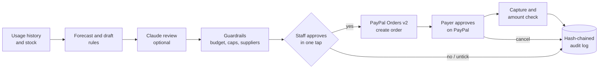

# CareStock Agent

**An AI purchasing agent for care homes. It watches how fast consumables are used, drafts the reorder, and pays with PayPal only after a staff member taps "Approve".**

Built for the PayPal AI Hackathon (Agentic Commerce).

## The problem

In residential care homes, adult briefs, gloves, wipes and food thickener are used every hour of every day. Running out is not an inconvenience: it means a resident waits in a wet brief, or a meal cannot be served safely to someone with swallowing difficulties.

Yet reordering is usually done by a nurse or care worker at the end of a shift: count the shelf, guess, phone or click through a supplier site, then chase a manager for payment approval. The team behind this project has worked in care settings for more than 17 years and has seen this go wrong often: emergency orders at retail prices, double orders, and no clear record of who spent what.

Fully autonomous buying is not acceptable in this setting either. Budgets are tight and every payment must be explainable to a manager or an auditor.

## What it does

1. **Forecast.** For each item, the agent reads 14 days of usage, weights the most recent week when usage is rising, and adds safety stock for the supplier's lead time.
2. **Draft.** It proposes a restock in whole packs, sorted by urgency ("will run out before a new delivery").
3. **Review (AI).** Claude reviews the draft and writes a two-sentence explanation for care staff. It may nudge quantities, but cannot add items, change prices or suppliers, or go more than +50% over the rule.
4. **Guardrails.** Manager-set rules are enforced in code after the AI and again at approval time: approved suppliers only, max packs per line, max amount per approval, monthly budget. Urgent items get the budget first; the rest is deferred, not dropped silently.
5. **One-tap human approval.** A nurse unticks anything they disagree with, enters their name, and taps **Approve & pay with PayPal**.
6. **PayPal payment.** The server creates a PayPal order (Orders v2) with itemized lines. The payer approves on PayPal, the server captures, and checks that the captured amount equals the approved amount.
7. **Audit trail.** Every step (proposed, approved by whom, PayPal order id, capture id, cancellation) is written to an append-only, hash-chained log. Editing any past entry breaks the chain and the UI shows it.

## How it works



```
Browser (index.html)
   |  POST /api/plans                -> agent drafts plan (forecast + AI review + guardrails)
   |  POST /api/plans/:id/approve    -> guardrails re-checked, PayPal order created
   v
PayPal checkout (sandbox, or the built-in mock page)
   |  return_url -> GET /paypal/return?token=ORDER_ID  -> capture + amount check + log
   |  cancel_url -> GET /paypal/cancel?token=ORDER_ID  -> log cancellation
```

## Where PayPal is used

All PayPal code is in [`src/paypal.js`](src/paypal.js):

| Step | PayPal API | Code |
| --- | --- | --- |
| Get an access token (client credentials, cached) | `POST /v1/oauth2/token` | `#accessToken()` |
| Create the order with itemized lines, `item_total` breakdown, `invoice_id`, `custom_id`, and `payment_source.paypal.experience_context` (return / cancel URLs, `PAY_NOW`, `NO_SHIPPING`) | `POST /v2/checkout/orders` | `buildOrderBody()`, `createOrder()` |
| Send the approver to the `payer-action` link | PayPal checkout | `createOrder()` returns `approveUrl` |
| Capture after approval | `POST /v2/checkout/orders/{id}/capture` | `captureOrder()` |
| Idempotency, so a double tap never pays twice | `PayPal-Request-Id` header | `#call()` |

The approve -> capture flow is wired in [`src/app.js`](src/app.js) (`approve()`, `capture()`, `cancel()`).

## Run it

Requires Node.js 20 or newer. No dependencies to install.

```bash
npm test          # 16 tests: forecast, guardrails, AI validation, PayPal client, full HTTP flow
npm run demo      # whole flow in the terminal
npm start         # http://localhost:3000
```

### Modes

| Setting | Behaviour |
| --- | --- |
| No PayPal keys | **Mock mode.** Same request bodies and flow; a local page stands in for PayPal checkout. No network calls, no money moves. |
| `PAYPAL_CLIENT_ID` + `PAYPAL_CLIENT_SECRET` (sandbox app) | Real PayPal sandbox: orders appear in your sandbox account; approve with a sandbox buyer account. |
| No `ANTHROPIC_API_KEY` | Deterministic rule-based reviewer writes the summary. |
| `ANTHROPIC_API_KEY` set | Claude reviews the draft. If the call fails, the agent falls back to rules and says so in the plan. |

Copy `.env.example` to `.env` and fill in values. `.env` is git-ignored. Keys are never printed or written to the log; the server only prints which mode it is in.

The audit log is stored in `data/ledger.jsonl` (git-ignored). Delete it to start a fresh demo.

For the sandbox, set `BASE_URL` to the address PayPal should send the payer back to (default `http://localhost:3000`).

## Demo data

All data is fictional: "Maple Grove Care Home (fictional)", 40 beds, 8 consumables, three demo suppliers. No real facility, resident, staff or customer data is included.

## Project layout

```
src/demo-data.js   fictional inventory, usage history and manager rules
src/forecast.js    usage forecast and reorder draft
src/agent.js       AI review (Claude or rules) and validation of AI output
src/policy.js      guardrails: suppliers, caps, per-approval limit, monthly budget
src/paypal.js      PayPal Orders v2 client (sandbox/live) and mock
src/ledger.js      append-only hash-chained audit log
src/app.js         propose -> approve -> pay -> record workflow
src/server.js      HTTP server and routes
public/index.html  staff UI
test/              node:test suites
```

## What is next

- Delivery confirmation that moves "on order" into stock, and supplier invoice matching.
- PayPal vaulting so a manager-approved payment method can be reused within the same limits.
- Multiple sites with a shared budget and per-site approvers.

## License

MIT. See [LICENSE](LICENSE).
